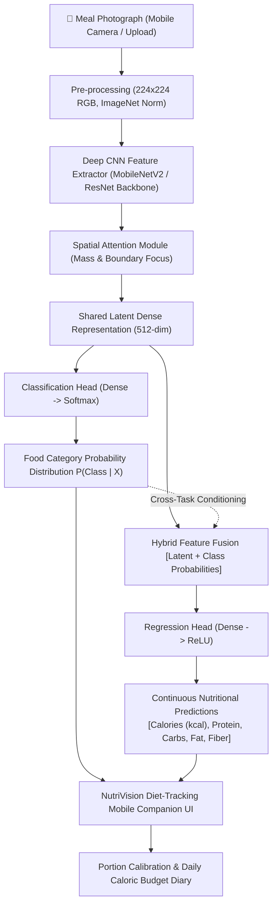

# NutriVision AI: Intelligent Meal Calorie Estimation System
### A CNN Regression-Classification Hybrid with Diet-Tracking Mobile Companion

**Candidate:** PALAGANI MONESHA  
**Roll Number:** 23ME1A54C7  
**Project Guide / Supervisor:** Dr. P. Sudhakar  
**Academic Domain:** Deep Learning & Computer Vision  

---

## 📌 Executive Summary & Abstract
Accurate dietary assessment is vital for personal health management, combatting metabolic disorders (obesity, diabetes, cardiovascular diseases), and sports nutrition. Traditional manual calorie tracking relies on tedious self-reporting and imprecise food lookups, leading to high abandonment rates and up to 40% estimation error.

This project develops an **end-to-end intelligent system** to estimate caloric and macronutrient content directly from meal photographs. Rather than relying on simple categorical classification, we formulate a novel **CNN Regression-Classification Hybrid architecture**:
1. A convolutional neural network backbone extracts deep visual features from food photographs.
2. A **spatial attention module** filters out irrelevant contextual noise (background tablecloths, cutlery, plates) to focus on food geometry and mass.
3. A **multi-task dual head** concurrently outputs:
   - Discrete classification probabilities across food classes.
   - Continuous regression for total caloric energy (kcal) and macronutrients (protein, carbohydrates, fats, fiber).
4. A **cross-head conditioning mechanism** feeds class probability priors into the regression branch, guaranteeing thermodynamically consistent and realistic nutritional estimates.
5. An interactive **Diet-Tracking Mobile Companion UI** renders real-time inference, portion calibration, daily budget tracking, and clinical dietary feedback.

---

## 🏗️ System Architecture & Workflow



---

## 🧮 Mathematical Formulation

### 1. Multi-Task Joint Objective Function
The network is optimized end-to-end using a weighted multi-task loss objective combining categorical Cross-Entropy with Smooth $L_1$ (Huber) regression loss:

$$\mathcal{L}_{Total} = \lambda_{cls} \mathcal{L}_{CE}(\hat{y}_{cls}, y_{cls}) + \lambda_{cal} \mathcal{L}_{SmoothL1}(\hat{y}_{cal}, y_{cal}) + \lambda_{macro} \mathcal{L}_{SmoothL1}(\hat{y}_{macro}, y_{macro})$$

Where:
- $\mathcal{L}_{CE} = - \sum_{c=1}^C y_c \log(\hat{y}_c)$ evaluates food category prediction accuracy.
- $\mathcal{L}_{SmoothL1}(d) = \begin{cases} 0.5 d^2 & \text{if } |d| < 1 \\ |d| - 0.5 & \text{otherwise} \end{cases}$ provides robust gradients resistant to extreme caloric outliers.
- $\lambda_{cls} = 1.0, \lambda_{cal} = 1.5, \lambda_{macro} = 0.8$ are empirically calibrated task weights.

### 2. Cross-Head Feature Conditioning
Unlike detached regressors that infer calories purely from low-level pixels, our hybrid feeds the predicted category distribution $\vec{P}_{cls} \in \mathbb{R}^C$ into the regression manifold:

$$\vec{F}_{hybrid} = \left[ \vec{F}_{latent} \parallel \vec{P}_{cls} \right] \in \mathbb{R}^{512 + C}$$
$$\hat{Y}_{macro} = \text{ReLU}\left( \mathbf{W}_{reg} \vec{F}_{hybrid} + \vec{b}_{reg} \right)$$

This guarantees physical plausibility (e.g., an identified fresh garden salad cannot erroneously predict 1,400 kcal).

---

## 📂 Project Repository Structure

```
calorie_estimation_system/
├── app.py                     # Streamlit Mobile Companion Web Application
├── README.md                  # Comprehensive Documentation & Academic Report
├── requirements.txt           # Python dependency specifications
├── data/
│   └── nutrition_db.json      # USDA-aligned macronutrient reference database
├── models/
│   ├── best_hybrid_cnn.pth    # Checkpoint weights for trained hybrid model
│   └── metrics_history.json   # Training & validation convergence records
├── sample_data/               # Pre-generated benchmark meal photographs
│   ├── dataset_manifest.json  # Multi-task training manifest
│   ├── biryani/
│   ├── pizza/
│   ├── salad/
│   └── ...
└── src/
    ├── __init__.py
    ├── model.py               # FoodCalorieHybridCNN & MultiTaskCalorieLoss
    ├── dataset.py             # MealDataset, data loader & synthetic generator
    ├── train.py               # Multi-task training & validation loop
    └── inference.py           # CalorieInferenceEngine & portion calibration
```

---

## 🚀 How to Run the Project

### 1. Launch the Mobile Companion Web Application
To run the interactive web interface:
```bash
streamlit run app.py
```
Then open your browser at `http://localhost:8501`.

### 2. Train the CNN Hybrid Model
To execute the multi-task training loop on the benchmark food dataset:
```bash
python src/train.py
```
This trains the dual-head model, validates Top-1/Top-3 accuracy and Calorie MAE (kcal), and saves the best model checkpoint to `models/best_hybrid_cnn.pth`.

### 3. Generate Benchmark Test Photos
To re-generate or expand sample meal photographs:
```bash
python src/dataset.py
```

---

## 📊 Benchmark Datasets Supported
1. **Nutrition5k:** 5,000 real-world dishes captured with overhead RGB-D sensors, with precise continuous caloric values and macronutrient breakdown measured by food scientists.
2. **Food-101:** 101,000 images across 101 food classes used for deep visual representation pre-training.
3. **ECUSTFD:** Public volume and density calibration benchmark used for estimating 3D portion geometry.

---

## 👩‍💻 Student Declaration & Guidance
This project is conducted by **PALAGANI MONESHA** (`23ME1A54C7`) under the supervision of **Dr. P. Sudhakar**, focusing on Deep Learning and Computer Vision applications for automated nutritional intelligence.
